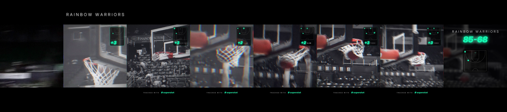

# superstat-montage

**One tap: Superstat game film becomes a TikTok mixtape edit.** It's built in the style of the edits that actually perform in hoops TikTok, and every post carries the player's Superstat stats and a "tracked with superstat" sign-off.



Demo: [`demo/hellraiser_template_demo.mp4`](demo/hellraiser_template_demo.mp4). It's exported silent, the way the edit is meant to be posted: add the sound "HellRaiser" in TikTok starting at 0:11.87, and every make lands on the beat with the ball going through the net.

## Why this, and why only this

Superstat's highlight posts today are real-time clips with a stat card, and they get tens of likes. The #mixtape edits on the "HellRaiser" sound get tens of thousands: the two benchmarks used here have **31K likes / 330K views** and **19.5K likes / 118K views**. They follow a very specific recipe.

So this MVP does **one template, done properly**, instead of many done badly:

- **One sound:** "HellRaiser" by SlimeGetEm, mapped beat by beat ([`montage/template.py`](montage/template.py))
- **One look:**
  - colour intro, then a washed black-and-white grade where only reds and the ball stay coloured
  - 1:1 frame letterboxed in black, with grain and a vignette
  - flash, RGB split, shake and zoom punch, all driven by the song's hits
- **One Superstat layer:** the only saturated colour on screen is Superstat green, which is the stats:
  - a small **stat chip** in the top-right corner with a **shot map** (Superstat's Court View). On each make the ball's arc draws from the shot spot to the rim during the slow-mo, then a green dot drops and the chip flashes `+3 THREE`.
  - the stat hook under the name ("7 THREES")
  - an end card with the final line and the **full shot chart** filling in dot by dot on the beats

## The cut sheet

The sound is used from **0:11.87**, where the reference edits start it. Tempo is 140 BPM, so 1 beat = 0.4285s.

| beat | in the song | in the edit |
|---|---|---|
| 0–4 | quiet build | make #1 build-up in **full colour** |
| **4** | first hit | ball through the net, **switch to black and white**, name tag + stat hook |
| **12** | second hit | make #2 lands |
| 14–20 | build to the drop | make #3 with a long slow-mo "hang" on the ball in the air |
| **20** | **THE DROP** | the best make lands; hardest flash, shake and RGB split |
| 23, 27, 31 | 808 hits | remaining makes land on the 808s; a zoom pulse on every beat |
| last 8 beats | | freeze, then final line + "tracked with superstat" |

Each make is placed so the ball goes through the net **on its beat**. The speed ramps (real time, then slow-mo into and out of the make) are monotone cubic curves, so they feel smooth but still hit every keyframe exactly. The template works with 2–5 made shots. With only 2, the second make gets its whole possession as the build-up into the drop, and a tight slow-mo replay of that swish lands on the next 808. Only shots the footage actually shows going in should be used; a make that's cut off before the ball drops can be tagged `"miss"` to leave it out.

A **virtual camera** settles on the net just before each make, so the swish is always in frame (`rim` on each event). With shooter tracking (`release`, `shooter`) it starts tight on the shooter at release, glides with the ball to the rim, then eases out for the reaction. In production, Superstat's player and ball tracking drives this. In the demo the shooter and rim positions are marked by hand (`release`, `shooter`, `rim` on each event).

## Posting it (and why it's exported silent)

The edit is exported **without audio**. The player posts it, adds the sound "HellRaiser" in TikTok, and sets the sound's start to **0:11.87**. Every make then lands on the beat. That's the legitimate route: sounds added inside TikTok are covered by TikTok's licensing, and a downloaded file with the song baked in isn't.

For internal previews, `--sound path/to/hellraiser.mp3` muxes a local copy of the sound in at the right offset. Keep those previews out of public places.

## Run it

```bash
pip install numpy pillow          # plus ffmpeg on PATH
./examples/fetch_demo_footage.sh  # CC BY 3.0 demo footage
python -m montage --events examples/hawaii_vs_nau.json --player haw --out reel.mp4
```

Input is the event timeline Superstat already produces, plus the game video:

```json
{
  "game":    {"video": "game.mp4", "usable_top": 0.0, "usable_bottom": 1.0},
  "players": [{"id": "p1", "name": "Poppy Venn", "final_line": {"3PM": 7, "PTS": 23, "REB": 4}}],
  "events":  [{"id": "e1", "t": 3.70, "type": "3PT_MADE", "player_id": "p1", "shot": {"x": 0.87, "y": 0.43},
               "release": 2.30, "shooter": [0.53, 0.57], "rim": [0.16, 0.31]}]
}
```

`t` is when the ball goes through the net. `shot` is the shot location on a half court (`x` across from the left sideline, `y` out from the baseline, both 0–1), straight from Superstat's shot map. `final_line` is the official box score: it feeds the "7 THREES" hook and the end card. `usable_top` / `usable_bottom` keep the crop clear of burned-in graphics and watermarks. `clip_start` / `clip_end` stop a shot from crossing a cut in the source.

## How it plugs into Superstat

```
game upload -> Superstat CV -> made shots + box score + player/ball tracks    (already exists)
                                      |
                  player taps "Make my edit" in the app
                                      |
              render worker (this repo, ~1 min CPU per edit)
                                      |
      TikTok share sheet -> player adds "HellRaiser" at 0:11.87 -> post
                                      |
  viewers see 7 THREES + "tracked with superstat" -> install / team sign-up
```

Next templates follow the same pattern: map a trending sound once in `template.py`, and every player gets an edit that's in sync. With Superstat's segmentation, the next step is keeping **the player's own jersey** in colour while everything else is washed out, which top editors do by hand.

## Limitations

- The demo makes were timed and framed by hand, and the shot locations were estimated from the footage. In production all of this comes from Superstat's CV and shot map.
- The public demo uses a broadcast highlight package, which has cutaways and burned-in graphics. Raw single-camera game film, which is what Superstat processes, works better.

## Credits

Demo footage: "Hawaii Basketball - Highlights From Northern Arizona Game" by Warrior Insider ([vimeo.com/301560697](https://vimeo.com/301560697)), [CC BY 3.0](https://creativecommons.org/licenses/by/3.0/), via Wikimedia Commons. It was cut, cropped, retimed, graded and overlaid. "HellRaiser" © SlimeGetEm; it isn't included in this repo. Superstat name and colours © Superstat; this is an unofficial prototype.
